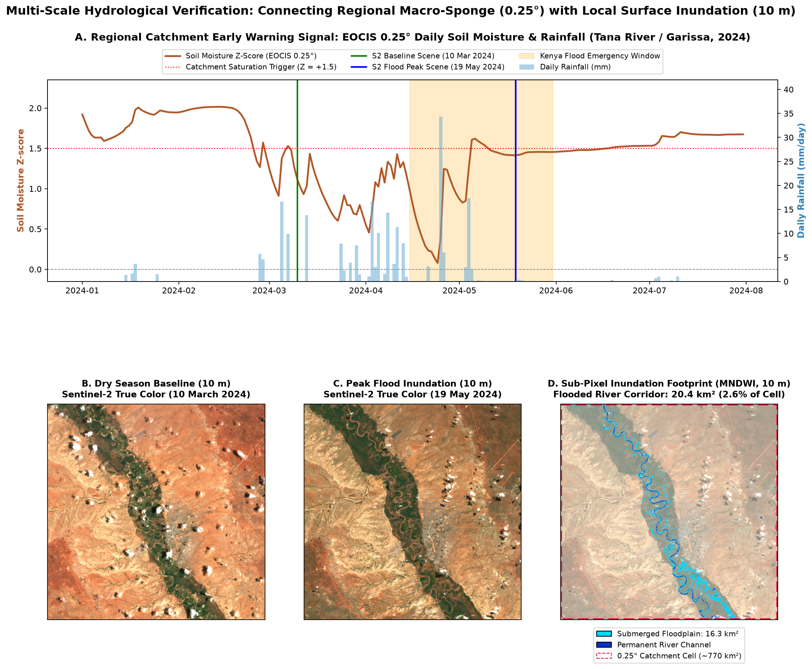

# Multi-Scale Satellite Flood Early-Warning and Parametric Risk Trigger (Kenya and Nigeria)

EODH Community Notebook Competition 2026 Submission  
Author: Flawiya S. More (Liverpool, UK)

## Key Submission Files
- Main Competition Notebook: [EODH_Community_Notebook_Competition_2026_Template.ipynb](EODH_Community_Notebook_Competition_2026_Template.ipynb)
- Official Submission Form: [EODH_Submission_Form_Template.md](EODH_Submission_Form_Template.md)
- Code Licence: [LICENSE](LICENSE) (MIT License)

## Overview and Research Question
Flood early-warning systems and parametric disaster insurance across Africa face a spatial scale mismatch: coarse satellite climate models (0.25 degrees, roughly 28 km) capture daily catchment soil wetness, but average out narrow floodplains, croplands, and towns across a 770 sq km grid cell. Treating a 28 km pixel as uniform causes basis risk, where uninhabited bushland (over 65% of a cell) hides the flood risk over critical towns (0.2%) and farmland (1.1%).

Primary Research Question:  
Can antecedent soil-moisture saturation from daily climate models (eocis-soil-moisture-africa, 0.25 degrees) be combined with 10 m land cover (clms-lcm-global-10m-yearly-v1-cog) and 10 m Sentinel-2 imagery (sentinel-2-c1-l2a) via pyeodh to create a reproducible flood early-warning trigger that reduces coarse-pixel basis risk?

## Datasets Used

Table 1: Summary of Earth observation datasets and validation inputs used in this repository.

| Dataset | Source / STAC Collection | Resolution | Role in Workflow |
|---|---|---|---|
| EOCIS Soil Moisture Africa v2.3.1 | EODH CEDA (eocis-soil-moisture-africa) | 0.25 deg, Daily (2000-2026) | 26-year root-zone soil moisture (0-1 m) and TAMSAT rainfall Z-score baseline |
| CLMS Global Land Cover (2020 v1) | EODH CEDA (clms-lcm-global-10m-yearly-v1-cog) | 10 m COG | Sub-pixel urban settlement and agricultural exposure profiling |
| Sentinel-2 Collection 1 Level-2A | EODH Element84 (sentinel-2-c1-l2a) | 10 m / 20 m COG | Windowed MNDWI flood extent verification (May 2024 Kenya flood peak vs. dry baseline) |
| geoBoundaries (ADM0 / ADM1) | Open License (data/summary/) | Vector polygons | National and state or county boundaries for Nigeria and Kenya |
| Dartmouth Flood Observatory (DFO) | HDX CC BY 4.0 (docs/dfo_events_nigeria_kenya.csv) | 62 Historical Events | Ground-truth flood disaster validation benchmark (2000-2024) |

## Key Visual Outputs

### 1. Multi-Scale Flood Verification (0.25-deg EOCIS vs. 10 m Sentinel-2 MNDWI)

Figure 1: Multi-scale verification of the May 2024 Garissa flood event comparing the daily 0.25-degree EOCIS soil moisture Z-score and rainfall series (panel A) with 10 m Sentinel-2 imagery before the rains on 10 March 2024 (panel B), at the flood peak on 19 May 2024 (panel C), and the MNDWI flooded corridor inside the 0.25-degree cell (panel D).

### 2. Resolving the 28 km Scale Mismatch (10 m CLMS Sub-Pixel Exposure)

Figure 2: Sub-pixel land cover map at 10 m resolution (panel A) and area breakdown by land cover class (panel B) inside a single 0.25-degree grid cell at Garissa, Kenya.

### 3. Historical Validation Across 62 Flood Disasters (Kenya vs. Nigeria)

Figure 3: Inter-annual percentile rank of historical flood event windows compared to the same calendar season in all other baseline years for Kenya and Nigeria.

## Repository Structure
```text
├── EODH_Community_Notebook_Competition_2026_Template.ipynb  # Official competition notebook
├── EODH_Submission_Form_Template.md                         # Official competition submission form
├── LICENSE                                                  # MIT License
├── requirements.txt                                         # Python package versions
├── data/summary/                                            # Lightweight (<3 MB) 26-year summary grids and time series
├── docs/                                                    # Catalogue summary, DFO event tables, validation metrics
├── outputs/figures/                                         # Figures (01 to 09)
└── src/                                                     # Data processing and verification scripts (01 to 09)
```

## Reproducibility and AI-Use Disclosure
1. Quick Run (under 60 seconds): Open EODH_Community_Notebook_Competition_2026_Template.ipynb in the EODH JupyterLab environment (or locally after running pip install -r requirements.txt) and run all cells.
2. Full 26-Year Rebuild (Optional): Run src/01_explore_catalogue.py through src/09_export_compact_summary.py sequentially to re-download all 9,528 daily NetCDF files from CEDA.
3. AI Disclosure: An AI coding assistant (Antigravity) assisted with STAC query syntax, script structure, and figure layout formatting. The author conceived the research framework, selected the study areas, designed the anomaly and basis-risk method, verified all citations, and wrote the hydrological interpretations.
