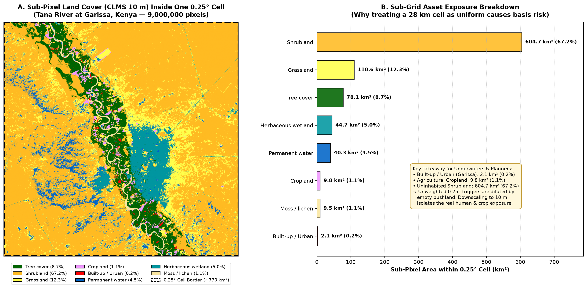
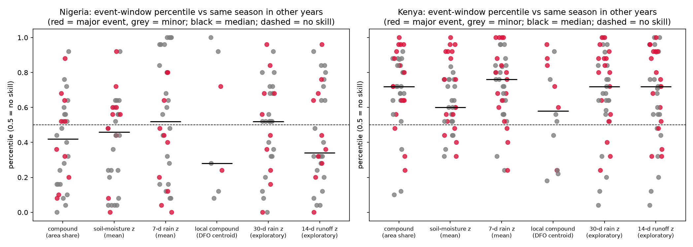

# Multi-Scale Satellite Flood Early-Warning & Parametric Risk Trigger (Kenya & Nigeria)

**EODH Community Notebook Competition 2026 Submission**  
**Author:** Flawiya S. More (Liverpool, UK)

## Key Submission Files
- **Main Competition Notebook:** [`EODH_Community_Notebook_Competition_2026_Template.ipynb`](EODH_Community_Notebook_Competition_2026_Template.ipynb)
- **Official Submission Form:** [`EODH_Submission_Form_Template.md`](EODH_Submission_Form_Template.md)
- **Code Licence:** [`LICENSE`](LICENSE) (MIT License)

---

## Overview & Research Question
Flood early-warning systems and parametric disaster insurance across Sub-Saharan Africa face a fundamental **spatial scale dilemma**: coarse macro-hydrological satellite models ($0.25^\circ \approx 28\text{ km}$) capture daily catchment water storage (the regional "soil sponge"), but average out narrow floodplains, croplands, and human settlements across a $\sim 770\text{ km}^2$ grid cell. Treating a $28\text{ km}$ pixel as uniform introduces severe **basis risk**, where uninhabited bushland ($>65\%$) dilutes the hazard signal over critical towns ($0.2\%$) and farmland ($1.1\%$).

**Primary Research Question:**  
*Can antecedent soil-moisture saturation from daily macro-hydrological models (`eocis-soil-moisture-africa`, $0.25^\circ$) be synergised with high-resolution land cover (`clms-lcm-global-10m-yearly-v1-cog`, $10\text{ m}$) and optical imaging (`sentinel-2-c1-l2a`, $10\text{ m}$ MNDWI) via `pyeodh` to produce an openly reproducible, decision-ready flood early-warning trigger that resolves coarse-pixel basis risk?*

---

## Datasets Integrated

| Dataset | Source / STAC Collection | Resolution | Role in Workflow |
|---|---|---|---|
| **EOCIS Soil Moisture Africa v2.3.1** | EODH CEDA (`eocis-soil-moisture-africa`) | $0.25^\circ$, Daily (2000–2026) | 26-year root-zone soil moisture ($0\text{--}1\text{ m}$) & TAMSAT rainfall $Z$-score baseline |
| **CLMS Global Land Cover (2020 v1)** | EODH CEDA (`clms-lcm-global-10m-yearly-v1-cog`) | $10\text{ m}$ COG | Sub-pixel urban settlement & agricultural exposure profiling |
| **Sentinel-2 Collection 1 Level-2A** | EODH Element84 (`sentinel-2-c1-l2a`) | $10\text{ m} / 20\text{ m}$ COG | Windowed MNDWI flood extent verification (May 2024 Kenya flood peak vs. dry baseline) |
| **geoBoundaries (ADM0 / ADM1)** | Open License (`data/summary/`) | Vector polygons | National and state/county masks for Nigeria and Kenya |
| **Dartmouth Flood Observatory (DFO)** | HDX CC BY 4.0 (`docs/dfo_events_nigeria_kenya.csv`) | 62 Historical Events | Ground-truth flood disaster validation benchmark (2000–2024) |

---

## Key Visual Outputs

### 1. Multi-Scale Hydrological Verification ($0.25^\circ$ EOCIS vs. $10\text{ m}$ Sentinel-2 MNDWI)


### 2. Resolving the $28\text{ km}$ Scale Dilemma ($10\text{ m}$ CLMS Sub-Pixel Exposure)


### 3. Empirical Validation Across 62 Historical Disasters (Kenya vs. Nigeria)


---

## Repository Structure
```text
├── EODH_Community_Notebook_Competition_2026_Template.ipynb  # Official competition notebook (runs in <60s)
├── EODH_Submission_Form_Template.md                         # Official competition submission form
├── LICENSE                                                  # MIT License
├── requirements.txt                                         # Python package versions
├── data/summary/                                            # Lightweight (<3 MB) 26-year summary grids & time series
├── docs/                                                    # Catalogue summary, DFO event tables, validation metrics
├── outputs/figures/                                         # High-resolution publication figures (01 to 09)
└── src/                                                     # Modular data processing & verification scripts (01 to 09)
```

---

## Reproducibility & AI-Use Disclosure
1. **Quick Run (<60 seconds):** Open `EODH_Community_Notebook_Competition_2026_Template.ipynb` in the EODH JupyterLab environment (or locally after `pip install -r requirements.txt`) and run all cells. The notebook connects live to `https://eodatahub.org.uk` via `pyeodh`, streams windowed $10\text{ m}$ CLMS and Sentinel-2 COGs over HTTP, and loads the compact 26-year baseline from `data/summary/`.
2. **Full 26-Year Raw Rebuild (Optional):** Run `src/01_explore_catalogue.py` through `src/09_export_compact_summary.py` sequentially to re-download all 9,528 daily NetCDF granules from CEDA.
3. **AI Disclosure:** An AI coding assistant (Antigravity) assisted with STAC query syntax, script scaffolding, and figure formatting. The author conceived the multi-scale research framework, selected the study areas, designed the anomaly and basis-risk methodology, verified all academic citations, and interpreted all hydrological findings.
